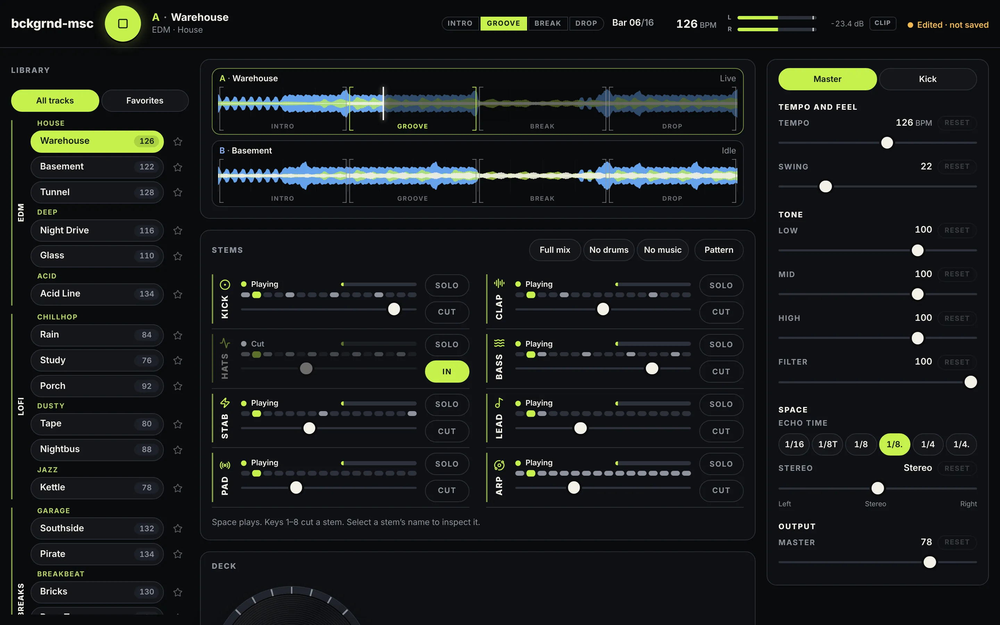

# bckgrnd-msc



A stem machine. Eighteen tracks, eight stems each. Cut any stem and the rest of the
instrumental keeps playing, so you build the track yourself while it runs.

**Live:** https://bckgrnd-msc.netlify.app

**Night 6 candidate:** browser projects, recovery, unified undo and WAV export;
NativePHP Desktop 2.4 on Linux; saved-project rendering in MCP. Release evidence
and remaining acceptance gates are in [NIGHT6_PROTOCOL.md](docs/NIGHT6_PROTOCOL.md)
and the [release checklist](docs/RELEASE_CHECKLIST.md). Production build `885e516519d1`
was verified in fresh and previously cached sessions. Windows, macOS and real
phones are untested. Pushed source is not deployment evidence.

The DSP is Rust compiled to WebAssembly, running inside an `AudioWorklet`. The music —
song form, note grid, swing, stem mix — is PHP. React draws the meters and sends intent,
and holds no audio state of its own.

The design rules every screen follows are in
**[docs/DESIGN_PHILOSOPHY.md](docs/DESIGN_PHILOSOPHY.md)**: music first, tactile
controls, clear feedback, progressive complexity. The six-night plan is in
**[docs/ROADMAP.md](docs/ROADMAP.md)**.

Design decisions live in **[docs/adr/](docs/adr/INDEX.md)**. Superseded notes are kept
in **[docs/archive/](docs/archive/README.md)** rather than deleted — each one says what
went stale about it.

## Quick start

Build environment: PHP ≥8.4.1, Node ≥22, pnpm 10.26, Rust, wasm-pack and wasm-opt.
The installed desktop app includes PHP and all audio assets; playback and WAV
export need none of these developer tools.

```bash
./start.sh          # build what's stale, start what isn't running
./start.sh --stop   # stop both servers
```

| URL | What it is |
|---|---|
| `http://localhost:8080` | Laravel. The app plus a live `/api` that computes the library and song form per request. |
| `http://localhost:8090` | Static files only. No PHP in the request path. The same shape as the Netlify site. |

What `start.sh` does:

| Step | When it runs |
|---|---|
| `composer install`, `pnpm install` | The lockfile or manifest is newer than the install. |
| Rust engine (`build:engine`) | Anything in `engine-core/src` or `Cargo.toml` is newer than the `.wasm`. |
| App and worklet (`build`) | The frontend, the wasm or the build config changed. |
| Track library export | Anything in `app/Support/Music` changed. |
| The two servers | Only the ones that aren't already answering. They run detached, so closing the terminal doesn't stop them. |
| `--stop` | Stops whatever is listening on `:8080` and `:8090`, and nothing else. |

Logs go to `/tmp/floor-laravel.log` and `/tmp/floor-static.log`.

**Use `localhost`, not the machine's IP address.** `AudioWorklet` only exists in a secure
context, and plain HTTP on a LAN address is not one. Over the IP the page renders fine and
then never makes a sound.

## Deploy

Netlify serves the static build. Its build image has no Rust or `wasm-pack`, so the site
is built here and uploaded:

```bash
pnpm run build:netlify
netlify deploy --dir dist --no-build --prod
```

`build:netlify` builds the engine, the app and the static export, then puts only what a
static host should serve into `dist/`. Saved presets need Laravel, so they aren't
available on the live site. Projects use browser IndexedDB on both Laravel and
static sites and the desktop's application-data folder through its native adapter.
Portable project files use the same format in all three runtimes.

The Netlify response headers block framing the app (clickjacking), embedded
plugin objects and cross-origin base URLs. The policy leaves JavaScript,
WebAssembly and AudioWorklet loading unchanged. The verified Night 6 deployment includes these headers; the local Laravel and static development servers do not
read `netlify.toml`.

## The screen

| Area | What's there |
|---|---|
| Transport (top, always visible) | Play/stop, the track, the song part and bar, the tempo, the master meter with a clip light, and whether the mix differs from the track as written. Projects shows the saved revision or unsaved changes and opens saving, recovery and export. |
| Library (left) | Tracks by section and style, with a star to keep favorites (stored in this browser only). On narrower screens it opens from the button in the transport. |
| Performance area (middle) | The two decks, the scene strip, the stems, the jog wheel and pads, loop, Release FX and Panic, and mixing to the next track. |
| Inspector (right) | **Master**: the effects rack, all knobs except the echo's note divisions. Select a stem's name to see that stem instead: its fader, its echo send, Solo and Cut. |
| Pattern editor (bottom) | Opened with **Edit patterns** beside the sound controls. Edit the drums, bass and lead one bar at a time while the track plays; see [Editing patterns](#editing-patterns). Escape closes it. |

On a phone the same panels show one view at a time: **Perform**, **Mix** and
**Edit**, from the tabs at the bottom. The transport stays at the top.

## The library

Three sections, each split into styles. Every track badge shows its bpm.

| Section | Style | Tracks | Tempo |
|---|---|---|---|
| EDM | House | Warehouse, Basement, Tunnel | 122–128 bpm |
| EDM | Deep | Night Drive, Glass | 110–116 bpm |
| EDM | Acid | Acid Line | 134 bpm |
| Lofi | Chillhop | Rain, Study, Porch | 76–92 bpm |
| Lofi | Dusty | Tape, Nightbus | 80–88 bpm |
| Lofi | Jazz | Kettle | 78 bpm |
| Breaks | Garage | Southside, Pirate | 132–134 bpm |
| Breaks | Breakbeat | Bricks, Rave Tape | 130–136 bpm |
| Breaks | Liquid DnB | Lowtide, Slipstream | 172–174 bpm |

Every track is a 16-bar form in four 4-bar parts: Intro, Groove, Break, Drop. The intro is
deliberately sparse — bar 2 is kick and hats, and the stab, lead and arp don't arrive
until bar 5. There's nothing to build if it starts full.

Clicking a track plays it. Nothing starts on page load.

## Stems

Eight per track. Keys 1–8 cut them in this order.

| Key | Stem | Notes |
|---|---|---|
| 1 | Kick | Its sub is tuned to the track's root. It ducks the stems under it, which is the pump. |
| 2 | Clap | |
| 3 | Hats | 808-style metal. Shaker, rimshot and congas ride this stem on the garage, breakbeat and lofi tracks. |
| 4 | Bass | Acid Line and Rave Tape run it through a four-pole ladder filter. |
| 5 | Stab | |
| 6 | Lead | Ladder filter on the acid tracks too. |
| 7 | Pad | |
| 8 | Arp | |

The Stems panel explains how the eight sounds build the track. Each channel names
its role (such as **Short chords** for Stab or **Repeating notes** for Arp), shows
its keyboard shortcut and state, and has a vertical volume fader beside a live
audio meter. **Solo** lets you hear a sound on its own (or with other soloed
sounds); **Cut** takes it out and becomes **Bring in**. Only an explicit cut lights
that button. **Reset** restores the track's original volume for that sound.
Selecting the name opens its detailed controls, including its echo send, in the
inspector. The channels wrap into rows on smaller screens so all eight sounds are
available without sideways scrolling.

The state says why a stem is or isn't sounding:

| State | Meaning |
|---|---|
| Ready | Stopped. |
| Playing | Has notes in this bar. |
| Rests this bar | In the mix, but the song leaves it out of this bar (the stab, lead and arp wait for bar 5). |
| Cut | You cut it. |
| Solo | You soloed it. |
| Off: solo on Bass | Silent because another stem is soloed. |

Three quick selections sit above the stems: **All sounds**, **Drums only**, and
**Music only**. They change which sounds are cut and clear any solos immediately;
they leave your volume settings alone. Level, Solo, and Cut each have a short
explanation above the mixer. **Edit patterns** opens the pattern drawer.

Cut every stem and the echo and room tails fade out with them, in about 30 ms. Cut
just one and its tail rings out as usual. Solo a stem and the echo and room are
cleared first, so you hear that stem alone and not the tail of the one before it.

## Scenes

The **Scenes & comparison** panel sits below the stems: four pads, each holding a
whole mix of the track that's playing, followed by A/B comparison. Press a scene
and the mix changes at the chosen launch timing.

Each button has a short cue for its sound and a miniature eight-stem mixer, in
the same order as the Stems panel. The bars show the stored levels, with cut
sounds and sounds excluded by Solo left empty. Capturing or copying a mix updates
the preview; the original factory description is only used when it matches the
stored mix. Active, modified, and queued states stay visible on the button.

| Scene | What it does |
|---|---|
| Full | The track as written. Every stem at its own level, the effects at their defaults. |
| Sparse | The breakdown. Kick, clap, stab, lead and arp cut; hats, bass and pad carry it, with a little more room. |
| Build | The bass under half, the kick and top parts eased back, the filter closed to about 3.5 kHz with some resonance, the lows trimmed, the echo repeating longer. |
| Drop | The return. Kick and bass back at the track's level, the filter open, the pad and arp tucked under, the echo and room drier. |

The factory scenes are written relative to each track's own mix, so Drop never
pushes a stem past the track's level and never touches **Master**.

A scene holds every stem's level, echo send, Cut and Solo, and twelve knobs: Cutoff,
Resonance, Low, Mid, High, Echo time, Feedback, Return, Room mix, Decay, Width and
Balance. Tempo, swing, Master, the loop and the playhead stay out of it, so a launch
never moves the beat or the volume.

**Switch on** picks when a pad lands: **Now**, **Next beat**, or **Next bar**,
which is the default. The engine keeps the time on its own sample clock, not the
browser's, so a launch lands on the step, before that step's notes, at any tempo and
through a loop. The levels and effects glide in, the same as when you move them by
hand.

| What the pad says | Meaning |
|---|---|
| Sending… | The request is on its way to the engine. |
| Queued · Bar 5 | It lands at the start of bar 5. Press the same pad again to cancel it. Press another pad and that one launches instead, on the same bar. |
| Active | The engine applied it. A pad never reads Active before the sound has changed. |
| Active · Modified | A knob or fader has moved since. Press the pad to go back to the scene. |
| Available after mix | Scenes wait while Auto mix is running. |

While stopped, a scene applies at once and playback stays stopped.

**Cancel** clears the active scene and any queued launch, then immediately restores
the mix from before you started choosing scenes. It also restores any pattern lanes
those scenes changed. Switching between scenes keeps the same return point;
choosing a scene after Cancel starts a new one. Playback continues as it was.

**Shift+1–4** launch Full, Sparse, Build and Drop, on the Switch on timing. They do
nothing while you're typing in a field or have a knob focused.

A pad press only ever launches, so a click in the middle of a set can't overwrite a
scene. Everything else is in each pad's `…` menu:

| Menu item | What it does |
|---|---|
| (the description) | What the stored mix does, or a custom-mix note after it is captured or changed. |
| Capture current mix | Stores the current mix in that slot. A held Echo or Filter isn't part of it, only the mix under it. |
| Rename… | Up to 40 characters. A blank name is refused. |
| Duplicate to | Copies this scene into one of the other three slots. |
| Reset to factory | Puts the factory version back. |

Scenes stay with the track while it's loaded. Nothing saves them yet, and loading
another track starts it on its own factory scenes.

### Fill

**Drum fill** plays the track's one-bar drum fill, starting on the next bar, then drops
back into the groove as it is by then. Each track's fill is its own phrase-ending
bar with a change on the last beat, so it sounds like that track and not a stock drum
break. It only replaces the kick, clap and hats patterns, and it never brings back a
stem you cut.

The button reads **Fill · Bar 5** while it waits. Press it again to cancel. It's
disabled while the fill plays, while Auto mix runs, and while stopped, because a fill
needs playback.

### Compare A/B

Below the scene controls, with separate capture and listening buttons. It has
nothing to do with Deck A and Deck B: it's two mixes of the same track, on the same
deck and the same playhead, for this session only.

Capture **A**, change something, capture **B**, then flip between them. Each switch
lands on the Switch on timing, same as a scene. Move something while listening to B
and it reads **B · Modified**; **Update B** stores the change. A works the same way.
**Keep current** keeps what you're hearing and closes the comparison. **Exit
comparison** goes back to the mix from before the first capture. No scene is
overwritten either way, and loading another track closes the comparison.

## Editing patterns

The pattern editor changes the track itself, not just the mix. Edits land in the
music at the next bar while it plays, and at once while stopped. The playhead never
jumps to what you're editing.

The header says three things: what you're **Editing** (lane, bar, part), what's
**Playing**, and the **Change**: *Queued for bar 6*, then *In the music*.
**Follow playback** keeps the editor on the playing bar until you pick a bar or
start an edit. **Hear bar** jumps there and loops it.

| Lane | How |
|---|---|
| Drums (kick, clap, closed and open hat) | Press an empty step to add a hit, a hit to remove it; drag along a row to paint. The velocity row under the grid: drag a bar, or select several (Shift-click, **Select bar**) and **Set together** or **Adjust together**, or type a value. Making a hit quiet never removes it. |
| Bass, Lead | Click to add a note, drag to move, drag its right edge to change its length; arrow keys nudge, Alt+arrows resize. A note can't land on another one. Chords stay chords. |
| Stab, Pad, Arp | Shown with their chords, not editable yet. |

**Copy**, **Paste**, **Duplicate to** and **Clear** say what they act on, for one
lane or all four drums. **Undo** and **Redo** (Ctrl/Cmd+Z, Shift+Ctrl/Cmd+Z) step
back through every edit, one gesture at a time, even while the track plays.

**Humanize** moves velocities a little: seeded, with an amount, and it keeps the
accents if you ask. **Vary** asks the PHP side for a new take on the four-bar part
on screen: Subtle, Moderate or Adventurous, by seed. The same seed gives the same
take. Bass and lead vary only in rhythm, because no track records its harmony yet.
Either way you hear a **preview** first: **Keep** makes it one undoable edit,
**Revert** puts the original back, and the mix you set while listening stays.
**Lock lane** (and Lock on a hit or note) keeps it out of Humanize and Vary. The
static build can only vary the tracks as written, and says so for a phrase you've
changed.

A scene captured after editing remembers those lanes and brings them back when it
launches. Save the project to retain them. The waveforms and stem activity follow
the accepted revision actually sounding; queued edits stay identified in the editor.

## Projects and desktop

Click the revision-aware save status to open Projects. Save, Save As, reopen a
saved/recovery/previous revision, import or download a `.bckgrnd.json` file, and
export WAV. Open always starts stopped. Recovery never reruns an export. A failed
save keeps the working composition and prior committed copy. Browser storage is
local to its origin; explicitly import a downloaded project into the desktop.

Projects own their patterns and scenes. A track change starts a new identity.
Open/New/Import wait for an active crossfade; asynchronous writes and exports
capture their project and revision before starting. A/B is session-only: Keep
current or capture a scene to preserve it. Held gestures and unaccepted previews
are excluded. Full → Drop → Cancel restores the original mix and replaced lanes,
preserves playback, and saving records that restored composition.

The musical contract is v3, wrapped in snapshot v1 with renderer and source hashes.
Unknown newer versions are refused. Old imports leave the input file untouched.
Exports use a fresh isolated engine and an immutable revision, independently of
live playback. Project-wide Undo includes mix, scene and pattern changes.

Linux development: `composer native:install`, then `composer dev:desktop`
(`php artisan native:run --installer=pnpm`). Build with `php artisan native:build linux x64`.
Install the generated tar archive using `sh scripts/install-linux.sh /path/to/archive.tar.xz`,
or install the `.deb` with the system package manager. Launch **bckgrnd-msc** from
the desktop menu. Manual installs retain previous versions and project data.
Automatic updates are disabled. See [the native inventory](docs/NIGHT6_INVENTORY.md)
for storage paths, security settings and candidate limitations.

## The decks

Two decks, A and B, each with a waveform drawn from the arrangement. One is live; the
other holds whatever is in Next. Cutting a stem thins the live waveform.

| On the waveform | What it does |
|---|---|
| Drag | Scratches. The playhead holds where you grabbed it and the drag sets the speed: back plays the recent past in reverse, holding still is silence. Let go and the song drops in at the step under the head. |
| Tap | Jumps to that point. |
| `[ ]` brackets | The four song parts, named along the bottom. The live part lights up. |

You can only scratch the live deck, and not while a mix is running.

### Jog wheel

| Gesture | What it does |
|---|---|
| Touch | Drags the tempo down, like a hand on a spinning record. Resting still keeps dragging. |
| Turn forward / back | Bends the tempo up / down. |
| Wind back 80°, or flick back fast | Backspin. |
| Let go | The tempo snaps back. The disc coasts to a stop (the coast is visual only). |
| Arrow keys / Space | Bend / backspin, when the wheel has focus. |

The label turns at 33⅓ rpm while the deck plays, except under reduced motion.

### Deck pads

| Pad | What it does |
|---|---|
| Cue | Jumps the playhead back to the start. |
| Brake | Slows the transport to a stop on a curve. |
| Echo | The echo throw, while held: feeds the whole mix into the delay and opens the feedback up. Let go and the repeats ring out. |
| Filter | While held, closes the filter to about 880 Hz with a resonant edge, 1.5 dB quieter so it isn't louder than open. The inspector's heading reads **Filter · held**, and the knob keeps showing the mix under it. |
| Bend + / Bend − | Pushes the tempo while held, then returns it. |
| Backspin | Reverses the last 1.35 s of output and spins it back. |

Echo and Filter sit on top of the mix instead of changing it. Let go and you hear the
mix as it is now: hold Filter, launch Drop, let go, and it's Drop's open filter that
comes back. They also let go on their own when the window loses focus or the tab is
hidden, and they're off while Auto mix runs.

Three ways out, kept apart on purpose:

| Button | What it does |
|---|---|
| Cancel (scene strip) | Clears the scene selection and queued launch, restoring the mix from before scene choices. |
| Release FX (under the pads) | Lets go of a held Echo or Filter. The mix stays exactly as it is. |
| Panic (under the pads) | Stops both decks, cancels the queued scene and fill, lets go of every held effect, clears the echo and room tails, and abandons a running Auto mix. |

## Controls

The continuous controls in the inspector are knobs. Each one:

| Gesture | What it does |
|---|---|
| Drag up / down | Turns it. A full sweep is 180 px. Hold **Shift** for ten times finer. |
| Drag round | Turns it with the hand instead, when **Knobs turn by dragging** is set to **Round** (at the bottom of the inspector, remembered in this browser). |
| Double-click / double-tap | Back to its default. So does the **Reset** badge, which appears once it has moved. |
| Click the value | Type one: `1.2k`, `-6 dB`, `35%`, `kill`, `open`. Enter sets it, Escape leaves it. |
| Keyboard | Arrows step 1% (Shift 0.1%), Page Up/Down 10%, Home/End the ends, Delete resets, Enter types a value. |

| Control | What it does |
|---|---|
| Loop | 1, 2, 4, 8 or 16 bars, snapped to a bar boundary. Click the lit one to turn it off. |
| Tempo | Retimes the grid, the duck recovery and the delay together. Whole BPM, 60–180. |
| Swing | Pushes every other sixteenth late. |
| Cutoff | One tape-style lowpass sweep, 240 Hz to 18 kHz, exponential under the hand. Reads **Open** at the top. |
| Resonance | The filter's Q as it closes, 0.5 to 6. It fades out over the last tenth of the cutoff's travel, so an open filter stays transparent. |
| Low / Mid / High | Isolators: low shelf 180 Hz, mid bell 1 kHz, high shelf 3.2 kHz. Unity at twelve o'clock, **Kill** at the bottom, +2.9 dB at the top. |
| Echo time | 1/16, 1/8T, 1/8, 1/8. (default), 1/4, 1/4. — the stem echo's delay. Click the lit one to turn the echo off; what's already in it rings out. |
| Feedback | How long the echo keeps repeating, 0–90%. |
| Return | How loud the echo comes back. The echo throw holds feedback and return open while you hold it and gives them back after. With the echo off, both are disabled: they have nothing to act on. |
| Room mix / Decay | The room under the mix: 0–50%, and 0.2 to 2.5 s. |
| Width | 0% is mono, 100% as mixed, up to 150%. |
| Balance | Turn it left and the right speaker fades out; turn it right and the left one does. Both play at full in the middle. Reads **R 10 %** on screen between the ends. |
| Master | Output level, in dB. |
| Stem fader | The stem's level. Double-click it, or press Delete on it, to go back to the track's own level. |
| Echo send (per stem) | How much of the stem feeds the echo. Each stem starts at its own amount and goes back there with a new track. |
| Master meter | Left and right peak of what leaves the engine, in the transport. Turns amber near the limiter. The **Clip** light holds for two seconds after any sample goes past full scale, which can only happen while a crossfade adds two decks together. |
| Space | Play / stop. |
| Shift+1–4 | Launch Full, Sparse, Build or Drop, on the Switch on timing. Not while typing or with a knob focused. |

Nothing moves the sound in a step. Every fader, cut, solo, send and knob glides
over 12–30 ms in the engine, so cutting a stem mid-note, slamming a fader or
hammering Cut doesn't click (`engine-core/tests/smoothing.rs`). A whole drag, a held
arrow key or a typed value is one edit, which is what undo will step through.

## Mixing

| Control | What it does |
|---|---|
| Next | The track Auto mix will bring in. The idle deck always shows it. |
| Auto mix | Crossfades to Next. The new track starts on a phrase boundary of the old one (or the next bar, if the phrase is too far off), at the old tempo, then eases to its own tempo over about twelve seconds. |
| Continuous mix — stem swap | At bar 12 it hands over to Next, and each handover steps the groups on: full mix, no drums, no music. Runs until you turn it off. |
| Continuous mix — song after song | The same handover, with the groups left alone. |

## Sound

Besides the stems, the engine adds a few things of its own.

| What | Where it's heard |
|---|---|
| Transitions | A noise riser into the Drop, a crash on its downbeat, a downsweep into the Break. Darker and quieter on lofi. They sit outside the stems, so no cut or solo stops them, and they only fire when playback actually crosses the seam — not on a jump, and not when a loop wraps back to one. None plays while a stem is soloed, and launching a scene never makes one. |
| Master chain | Stereo-linked compressor, saturator, the isolators and filter, then a safety limiter with a −0.3 dBFS ceiling. |
| Echo | A stereo ping-pong: repeats alternate left and right. |

## How it's split

The line between the three languages is the one architectural decision worth knowing
([ADR-001](docs/adr/001-php-owns-the-music-rust-owns-the-dsp-react-only-renders.md)):

| Layer | Owns | Where |
|---|---|---|
| PHP | The music: song form, note grid, swing, tempo, stem mix. The API serves arranged JSON. | `app/Support/Music/` |
| Rust → wasm | All DSP: oscillators, envelopes, filters, drums, the master bus, scratch and transitions. Renders events it's handed and never decides a note sequence. | `engine-core/` |
| React | Draws meters and sends intent. No audio state, no DSP, no musical clock. | `frontend/` |

Saved musical data and playback telemetry are kept apart. The parameters and the
project format that the UI, PHP and the MCP companion share are in
**[contracts/](contracts/README.md)**.

The DSP runs in an `AudioWorklet` rather than a `ScriptProcessorNode`, so the timing is
sample-accurate and nothing depends on the main thread keeping up. The worklet holds two
engines, one per deck.

Laravel is deliberately stateless: no sessions, no CSRF, no database. Presets are JSON
files on disk ([ADR-002](docs/adr/002-laravel-runs-stateless.md)).

## Scripts

| Command | What it does |
|---|---|
| `pnpm run build:engine` | Rust engine → `public/wasm/` via `wasm-pack`. |
| `pnpm run build` | Worklet and app → `public/build/`. |
| `pnpm run build:static` | The PHP-free shell, `public/index.html`, and the variation catalog. |
| `pnpm run build:netlify` | Engine, app and static export, assembled into `dist/`. |
| `pnpm run dev` | Vite dev server with the worklet on watch. |
| `composer test` | PHPUnit, Rust tests, parity, arrangement, the contract, the scene and editing logic, `verify:audio`, `verify:ui` and `verify:editor`. The last three need the app running on `:8080`. |

## Checks

| Command | What it checks |
|---|---|
| `cargo fmt --check --manifest-path engine-core/Cargo.toml` | Formatting. |
| `cargo clippy --all-targets --manifest-path engine-core/Cargo.toml -- -D warnings` | Must be clean. |
| `cargo test --release --manifest-path engine-core/Cargo.toml` | The engine. |
| `pnpm run typecheck` | `tsc --noEmit`. |
| `composer test:php` | PHPUnit: the song form for every track, the API, the static export matching the API, presets, and the project contract. |
| `pnpm run check:contract` | The UI's project reader against the same fixtures as PHP's, scenes included. |
| `pnpm run check:scenes` | The scene logic: the vector order, captures copied and not shared, revisions, and a settled request staying settled. |
| `pnpm run check:editing` | Pattern editing: undo exactness, one revision per gesture, the velocity floor, paste and duplicate rules, chords, humanize determinism and locks. |
| `pnpm run verify:ui` | The layout at five widths, keyboard focus, the stem states, the inspector, the drawer and the phone views. |
| `pnpm run verify:editor` | The pattern editor in Chromium: edit bar 9 while bar 2 plays, undo, duplicate, a bass note, humanize and variation preview/keep/revert, scenes with lanes, the phone's eight-step view. |
| `pnpm run verify:audio` | Drives the real worklet in Chromium and asserts audio, pattern edits landing on the bar included. |
| `pnpm run verify:static` | The same, against the static build, plus no API calls and the variation catalog. |
| `pnpm run verify:projects` | Save/reopen/export, Cancel restoration, failure, recovery, migrations and preview exclusion. |
| `node tools/verify-transitions.mjs` | Actual forward playback across Break and Drop, with bounded event conditions. |
| `node tools/verify-resume.mjs` | Simulated audio interruption and failed/successful resume. |
| `node tools/verify-native.mjs` | Installed Linux/X11 file dialogs, persistence, close failures and export cancellation. See release protocol for its test-only environment variables. |
| `NATIVE_CDP=http://127.0.0.1:9224 node tools/verify-render-parity.mjs` | Actual browser/native export workers against MCP at identical settings. |
| `php tools/check-arrangement.php` | The 16-bar form. |
| `php tools/compare-with-original.php tools/reference.json` | Parity with `old/`. |

`verify:audio` taps the worklet through an `AnalyserNode` into a zero-gain sink. It proves
correct samples leave the worklet. It does not prove audio reaches a speaker, and it can't
see the audio thread's console — a throw inside `process()` is swallowed by the browser,
which is why there's an explicit error channel to the UI. `verify-transitions`
now covers Break and Drop during actual forward playback; a seek would suppress
the transition sounds. The telemetry gate waits for signal/events within a bound.

The browser checks look for Chromium in Playwright's cache. Set
`PLAYWRIGHT_CHROMIUM=/path/to/chrome` to use another one.

`/probe.html` is the audio probe for a new shell (a NativePHP window, a packaged
build, a phone): it boots the engine, plays a moment of Warehouse, and reports
whether sound came out. See [docs/NIGHT6_INVENTORY.md](docs/NIGHT6_INVENTORY.md).

`window.__BCKGRND_DIAG__()` prints context state, sample rate, worklet availability,
meters and the last error.

The engine's defects found and fixed during the port, and the audio notes behind them,
are recorded in [the current handoff](docs/sessions/2026-11-06-night6-release.md). Open items are in
[PARKING_LOT.md](PARKING_LOT.md).

## Coming next: a mobile app

I'm planning to package this as a phone app with NativePHP. The desktop side of
NativePHP (`nativephp/desktop`) is in `composer.json`; mobile is a separate package
and isn't set up yet. Device audio, interruptions, screen locking, safe areas,
two-finger gestures and touch screen readers remain untested. The open questions are in
[PARKING_LOT.md](PARKING_LOT.md).

## `old/`

`old/` is the first version of this: a TanStack Start app running the engine in Web
Audio and TypeScript, deployed at `bckgrndmsc.grok.me`. It's the reference for how this
should sound and for the musical content of the original twelve tracks —
`tools/compare-with-original.php` checks the arrangement against a dump of its source, so
the comparison is against something independent rather than against this port's own
output.

It still runs on its own, nothing here reads from it at runtime, and it doesn't need to be
started to use this app.

## License

MIT. See [LICENSE](LICENSE).
